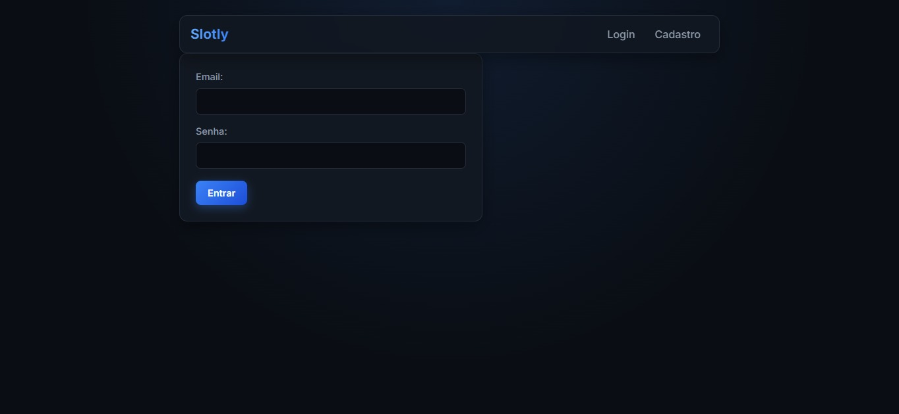
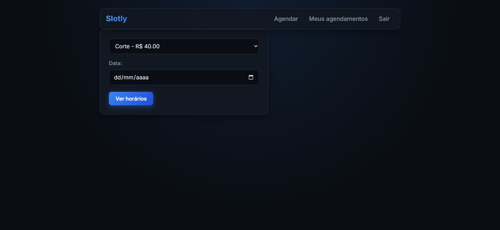
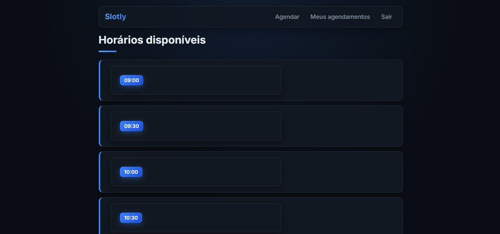
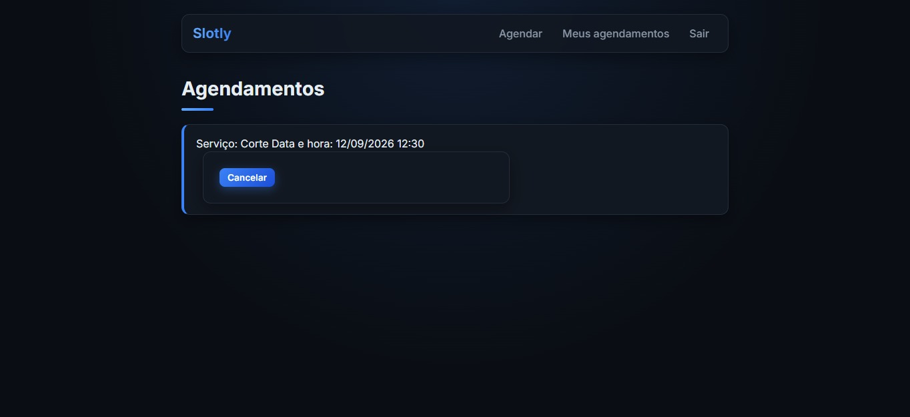
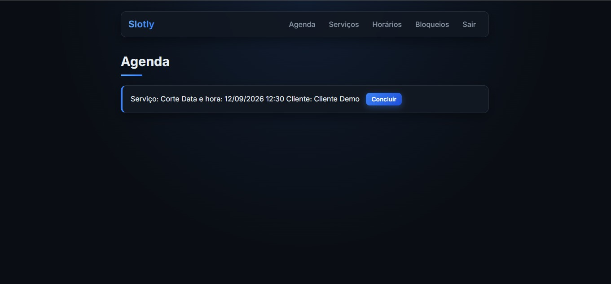

# Slotly

Sistema de agendamento online para barbearia, desenvolvido com Python, Flask e PostgreSQL.

🔗 **Acesse online:** [slotly-vobt.onrender.com](https://slotly-vobt.onrender.com)

> ⏳ O projeto está hospedado no plano gratuito do Render. Depois de alguns minutos sem acesso, o servidor "dorme", e o **primeiro acesso pode levar cerca de 1 minuto** para carregar.

## Teste com os usuários de demonstração

| Perfil | Email | Senha |
|---|---|---|
| Cliente | `cliente@slotly.com` | `demo123` |
| Barbeiro | `barbeiro@slotly.com` | `demo123` |

O barbeiro de demonstração atende de **segunda a sexta, das 09:00 às 18:00**, e **sábado, das 09:00 às 13:00**.

## Sobre o projeto

O Slotly permite que clientes reservem horários com o barbeiro **sem conflitos de agenda**. O sistema calcula os horários livres de cada dia a partir do expediente do barbeiro, descontando os horários já agendados e os bloqueios (folgas, feriados, compromissos), e respeita a **duração de cada serviço**.

Foi o meu primeiro projeto completo, construído do planejamento ao deploy: definição do MVP, modelagem do banco, back end, front end e publicação online.

## Prints

**Login**



**Agendamento (cliente)**



**Horários**


**Meus agendamentos (cliente)**



**Agenda (barbeiro)**



## Funcionalidades

**Cliente**
- Criar conta e fazer login
- Escolher serviço e data, e ver apenas os horários realmente livres
- Agendar com confirmação automática
- Ver os próprios agendamentos
- Cancelar com no mínimo 2 horas de antecedência

**Barbeiro**
- Cadastrar, editar e ativar/desativar serviços (nome, duração e preço)
- Definir os dias e horários de trabalho da semana
- Criar bloqueios pontuais (folgas, feriados, compromissos)
- Ver a agenda com os atendimentos confirmados
- Marcar atendimentos como concluídos

**Regras do sistema**
- Impede agendamentos sobrepostos, considerando a duração de cada serviço
- Respeita expediente e bloqueios do barbeiro
- Só permite agendar com login
- Senhas armazenadas com hash
- Cada perfil acessa apenas as telas permitidas

## Destaques técnicos

- **Cálculo de horários livres:** gera os horários do expediente em intervalos de 30 minutos e descarta os que se sobrepõem a agendamentos ou bloqueios, usando a regra de sobreposição de intervalos (`início_novo < fim_existente` e `fim_novo > início_existente`).
- **Autenticação:** senhas com hash (Werkzeug), sessão do Flask e decorators próprios (`login_obrigatorio` e `barbeiro_obrigatorio`) para proteger as rotas por perfil.
- **Modelagem:** banco modelado primeiro no Oracle SQL Developer Data Modeler e implementado como modelos SQLAlchemy em PostgreSQL, com chaves estrangeiras, relacionamentos e check constraints.
- **Templates:** herança de templates com Jinja (`base.html`), menu que muda conforme o perfil e mensagens de feedback com `flash`.

## Tecnologias

- **Back end:** Python, Flask, Flask-SQLAlchemy, Werkzeug
- **Banco de dados:** PostgreSQL (Neon em produção)
- **Front end:** HTML, Jinja e CSS
- **Deploy:** Render e Gunicorn
- **Versionamento:** Git e GitHub

## Modelo de dados

| Tabela | Descrição |
|---|---|
| `usuario` | Clientes e barbeiro (nome, email, senha com hash, perfil) |
| `servico` | Serviços oferecidos (nome, duração, preço, ativo) |
| `agendamento` | Liga cliente e serviço, com início, fim e status (confirmado, cancelado, concluído) |
| `horario_trabalho` | Expediente semanal do barbeiro (dia da semana, início e fim) |
| `bloqueio` | Períodos indisponíveis pontuais (folgas, feriados) |

## Estrutura do projeto

```
Slotly/
├── app/
│   ├── main.py            # aplicação Flask: modelos, regras e rotas
│   ├── static/
│   │   └── style.css      # estilo do sistema
│   └── templates/         # páginas HTML (Jinja), todas herdando de base.html
├── docs/
│   ├── Slotly.txt         # definição do MVP e user stories
│   ├── slotly_ddl.sql     # modelagem original do banco (Oracle)
│   └── prints/            # capturas de tela
├── seed.py                # cria os dados de demonstração
├── requirements.txt       # dependências
├── .env.example           # modelo das variáveis de ambiente
└── README.md
```

## Como rodar localmente

Pré-requisitos: Python 3, Git e PostgreSQL instalados.

```bash
# 1. Clonar o repositório
git clone https://github.com/devfcoelho/Slotly.git
cd Slotly

# 2. Criar e ativar o ambiente virtual
python -m venv venv
source venv/Scripts/activate   # Windows (Git Bash)
# source venv/bin/activate     # Linux ou macOS

# 3. Instalar as dependências
pip install -r requirements.txt

# 4. Criar um banco PostgreSQL chamado "slotly"

# 5. Configurar as variáveis de ambiente
cp .env.example .env
# edite o .env com sua DATABASE_URL e uma SECRET_KEY

# 6. Criar as tabelas e os dados de demonstração
python -c "from app.main import app, db; app.app_context().push(); db.create_all()"
python seed.py

# 7. Iniciar o servidor
flask --app app.main run --debug
```

Depois, abra `http://127.0.0.1:5000`.

## Roadmap

- [x] Planejamento e definição do MVP
- [x] Modelagem do banco de dados (Oracle)
- [x] Configuração do projeto, PostgreSQL e modelos SQLAlchemy
- [x] CRUD de serviços, horários de trabalho e bloqueios
- [x] Cadastro, login, logout e controle de acesso por perfil
- [x] Cálculo de horários livres e regra de conflito
- [x] Agendamento, cancelamento com prazo mínimo e agenda do barbeiro
- [x] Mensagens de feedback, navegação e CSS
- [x] Deploy

### Próximas melhorias

- Ajustar fuso horário para o horário de Brasília no servidor
- Lembretes e notificações (e-mail ou WhatsApp)
- Avaliação do atendimento
- Relatório de faturamento do barbeiro
- Testes automatizados com pytest

## Autor

Desenvolvido por **Felipe Coelho** · [GitHub](https://github.com/devfcoelho)